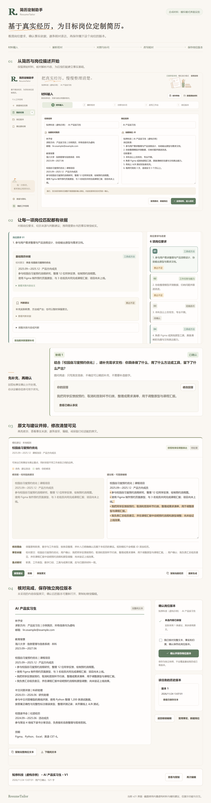

# 简历定制助手 · ResumeTailor

基于真实经历，为目标岗位定制简历。

将简历与岗位JD逐项对照，补齐影响表达的必要事实，再核对并保存岗位版本。用户始终决定事实是否确认、建议是否采用。

[合成示例](examples/README.md) · [产品需求](docs/PRD.md) · [流程图](docs/WORKFLOW.md) · [页面截图](docs/SCREENSHOTS.md) · [评测摘要](docs/EVALUATION_SUMMARY.md) · [阶段测试](docs/testing/README.md) · [典型Bad Case](docs/BAD_CASES.md) · [目录说明](docs/REPOSITORY_GUIDE.md)



展示长图使用合成材料与模拟模式，呈现当前界面和实际操作；[查看核心页面截图](docs/SCREENSHOTS.md)。真实模型评测见评测摘要。

## 产品流程

材料输入 → 解析校对 → 对照与补问 → 改写核对 → 保存岗位版本。

- **看清岗位与经历的关联**：保留岗位要求、经历来源及判断依据，支持用户调整。
- **围绕事实缺口补问**：允许确认、修改、未知或跳过；补充事实确认后才能用于改写。
- **逐条核对建议**：并列查看原文、建议、修改理由及来源；支持编辑或保留原文。
- **保存岗位版本**：保留不同任务和修改结果，可重新打开或导出本机备份。

JD用于确定表达重点，不能作为用户做过某项工作的证据。事实校验与用户核对共同约束工具、数字、职责和经历归属。

## 我的职责与关键产品决策

我负责产品的问题定义、需求范围与优先级、PRD和核心交互流程设计，以及评测标准制定、结果审核和迭代验收。代码实现、自动化测试和证据整理使用AI编程助手辅助完成；产品取舍与正式评分由我审核确认。

| 关键决策 | 原因与取舍 |
| --- | --- |
| 将解析、关联补问和改写拆成可核对的步骤 | 经历拆分或关联错误会影响后续建议。先让用户校对材料，再逐步生成，便于定位问题和纠正输入。 |
| 将岗位定向与事实来源分开，补问回答后另行确认事实 | JD决定表达重点，不能证明用户做过某项工作。只使用对应经历原文和已确认补充；允许未知或跳过，保留职责、数字与否定限定。 |
| 原文与建议并列，允许编辑或保留原文 | 用户需要判断改写是否值得采用。展示差异、理由和来源，不以改写数量衡量价值；原文适配时可以保留。 |
| 用固定案例检验迭代，事实核查独立于表达评分 | 保持案例和评分规则一致，区分流程完成、表达质量与事实准确性。程序校验通过后仍需核查语义，表达得分不能抵消事实错误。 |

具体设计见[PRD](docs/PRD.md)与[工作流](docs/WORKFLOW.md)；问题定位、修改和验证示例见[典型Bad Case](docs/BAD_CASES.md)。

## 评测摘录

以下为10组合成开发案例的历史评测与负责人确认的汇总口径。

| 指标 | 结果 |
| --- | --- |
| 简历建议成功生成比例 | v6：8/10 → v21：10/10 |
| 改写质量平均得分 | v6约5.41/8 → v21的85÷13＝6.54/8，按汇总均值估算约提升21% |
| 事实准确性检查 | v21改写正文13/13通过，核查覆盖13/13 |
| 单份简历人工修正量 | v6平均3.8次 → v21平均2.0次，减少约47%（同10组案例；负责人手工记录） |

v21评分为人工评分，经AI辅助复核后由负责人确认，非独立盲评。v6采用负责人确认的汇总值，未附逐单元评分；约21%不是逐单元配对结论。正文事实通过不代表所有上游判断正确。详细分母、评分规则和代码版本见[评测摘要](docs/EVALUATION_SUMMARY.md)。

### 人工修正计数口径

统计从基础简历输入到最终版形成的全过程，采用负责人手工记录，非系统自动统计。

| 产品环节 | 计数规则 |
| --- | --- |
| 材料输入与解析校对 | 纠正提取错误、项目名称、日期和职责等，计入解析修正。 |
| 岗位要求与经历关联 | 手动纠正关联或判断错误，计入关联修正。 |
| 动态补问与事实确认 | 正常回答问题、补充真实经历，不计入。 |
| AI改写与核对 | 纠正事实错误、遗漏、不准确措辞或表达不清，计入改写修正。 |
| 最终版本编辑 | 计入修改次数，但区分纠错与个人偏好调整。 |

两版总次数为38次和20次，均值分母均为10组。该指标不等同于正文事实错误数或人工耗时；逐例记录与证据范围见[评测摘要](docs/EVALUATION_SUMMARY.md#单份简历人工修正量)。

## 快速启动

需要Node.js 20.12或更高版本，无需安装npm运行依赖。使用PDF提取时，还需要Python及pypdf：

```powershell
python -m pip install -r requirements.txt
```

在项目目录打开终端，首次使用时复制配置示例：

```powershell
Copy-Item .env.example .env
```

已有.env时直接编辑，避免覆盖。默认AI_MODE=mock，可先体验本地模拟流程。

使用真实DeepSeek模型时，在本机.env填写AI_API_KEY，将AI_MODE改为live；配置示例使用deepseek-flash，思考模式为disabled。保存配置后重启服务。密钥由本机后端读取，不放入前端或Git。

```powershell
node server.mjs
```

Windows也可双击start-demo.cmd。保持启动窗口打开，访问默认地址http://127.0.0.1:4392；端口占用时修改.env中的PORT，以启动窗口地址为准。

真实调用前需在网页确认发送材料，费用由配置密钥的账户承担。普通编辑、复制及保存不调用模型。

## 离线测试

在项目根目录执行：

```powershell
npm test
```

使用Node内置测试框架，不需要API密钥，不调用付费模型。接口测试连接本机模拟服务；PDF测试需要Python及pypdf。当前整理版336项检查通过。运行条件、测试边界与验证记录见[tests/README.md](tests/README.md)。

## 网页回归

[qa/README.md](qa/README.md)提供5项隔离浏览器检查，覆盖PDF校对、岗位关联与补问、改写编辑、保存及刷新重开。安装独立测试依赖后运行`npm --prefix qa test`；使用模拟模式或本机固定响应，不调用付费模型。

## 使用与存储

1. 粘贴简历与JD，或上传可提取文字的PDF。
2. 核对解析材料、经历边界和岗位要求。
3. 检查关联，回答必要补问，核对并确认补充事实。
4. 选择改写内容，检查建议并编辑、接受或保留原文。
5. 保存岗位版本，在“我的任务”和“岗位版本”中重新打开。

任务与版本保存在当前浏览器。固定使用相同浏览器、地址和端口；在“数据与隐私”中可导出本机备份。扫描件可改用文本粘贴。

## 目录与版本依据

| 路径 | 内容 |
| --- | --- |
| public/ | 页面、状态交互、样式、图标与PDF预览资源 |
| lib/ | 模型调用、材料解析、来源与事实检查 |
| prompts/ | 固定的precise-followup-v21 Prompt |
| scripts/ | PDF文字提取脚本 |
| tests/ | 离线自动化检查、合成夹具、来源说明及验证记录 |
| qa/ | 可复用网页操作回归、隔离运行器与验证说明 |
| examples/ | 两组已完成真实网页操作的合成简历、JD、问答及保存结果 |
| docs/ | 产品设计、阶段测试、评测摘要、截图、案例及文件说明 |
| server.mjs | 本机后端入口 |

运行文件来源：58a25be1097a7902058a3c0a78415a2c90408cc5；Prompt：precise-followup-v21。历史评测代码与当前运行代码分别记录，不将历史结果改记为新测试。

[每个文件的用途](docs/REPOSITORY_GUIDE.md) · [完整文件索引](docs/FILE_INDEX.json) · [迭代记录](CHANGELOG.md)

PDF.js及相关字体、字符映射和解码组件的第三方许可证保留在public/vendor/pdfjs/中。
