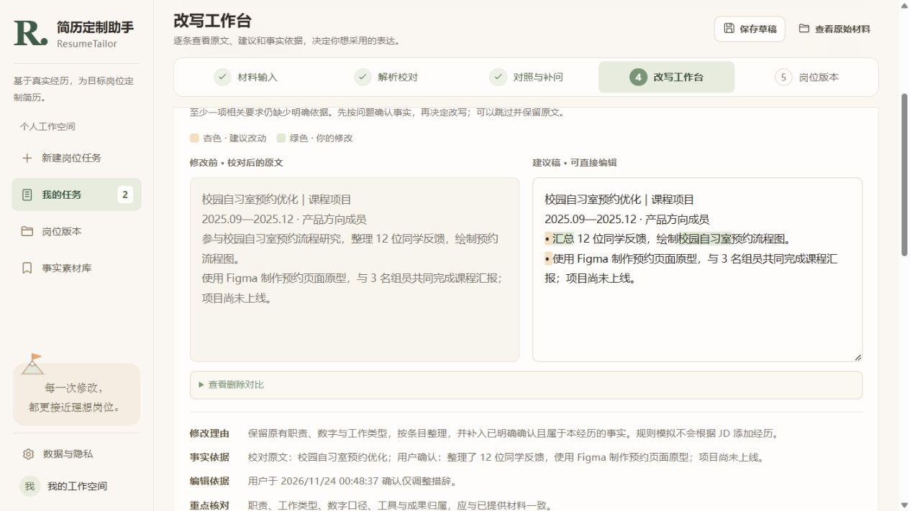

# Product Walkthrough and Screenshots

These images show the existing interface with built-in synthetic materials in mock mode. They illustrate layout and interaction, not real-model performance or a real-user trial. Text and model output were not replaced in the screenshots, and pages containing private resumes were excluded.

The interface remains in Chinese, matching the initial target audience. English captions explain the screens without altering the original captures.

## GitHub Homepage Walkthrough

The image presents four parts: material input, job matching and fact confirmation, rewrite review, and saving a role-specific version. It was captured in an isolated mock environment running the current v21 frontend, using the built-in synthetic resume and JD. Follow-up answers were also fictional demonstration material. The source captures were only cropped, proportionally resized, and arranged; explanatory headings were placed outside the screenshots.

- Format: 1440 × 5461 px, PNG, approximately 1.33 MB.
- Runtime source: `58a25be1097a7902058a3c0a78415a2c90408cc5`; prompt file: `precise-followup-v21`. Capture mode was `mock`, with no DeepSeek calls.
- The interface was used to confirm facts, generate mock suggestions, accept or keep text, and save a separate version. Text and factual states were checked after refresh and reopening.
- Image hashes and capture details are in the [walkthrough source record](evidence/product-overview.json). The three earlier screenshots are retained.

## Matching and Follow-Ups

Job requirements, experience evidence, and suggested judgments are grouped separately, with requirement navigation on the right. Users can adjust associations and follow-ups. The screen makes relevance and its supporting sources visible.

## Rewrite Review

Original and suggested text appear side by side, with differences, factual sources, and user-edit feedback. Users decide what to accept or keep for each item.

## Mobile Reading

On narrow screens, requirement navigation becomes horizontal while workflow, facts, and the rewrite selection remain accessible.

These screenshots show the frontend after the typography and readability refinements. Sources: S11–S14. Original image hashes are in the [evidence index](evidence/source-index.json).
