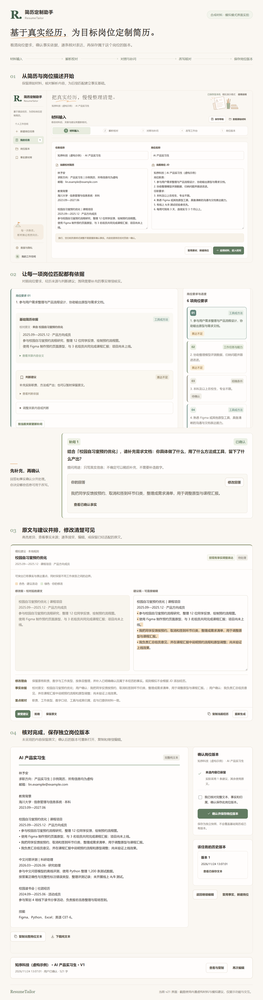
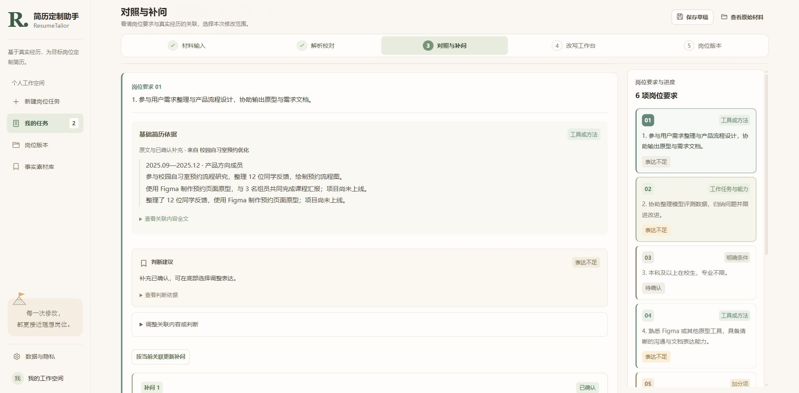
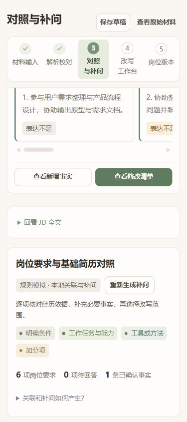

# 产品展示长图与核心页面截图

以下截图来自现有界面回归，使用内置虚构材料和模拟模式。仅展示页面布局与交互，不作为真实模型效果或用户内测证据。截图未改字、未替换模型输出；未采用包含私人简历的页面。

## GitHub首页展示长图

长图按材料输入、岗位匹配与事实确认、改写核对、保存岗位版本四个环节组织。它来自当前v21前端的独立模拟环境，使用内置虚构简历与JD；补问回答也为虚构演示材料。页面文本没有在截图中改写，原始截图仅作裁切、等比缩放和排版，说明标题置于截图外。

- 规格：1440 × 5461px，PNG，约1.33MB。
- 运行代码来源：58a25be1097a7902058a3c0a78415a2c90408cc5；Prompt文件仍为precise-followup-v21；实际截图运行模式为mock，没有调用DeepSeek。
- 已通过界面完成事实确认、生成模拟建议、接受或保留原文、保存独立版本；刷新重开后核对文本与事实状态一致。
- 图片与制作依据见[长图来源记录](evidence/product-overview.json)。原有三张截图继续保留。

## 对照与补问

岗位要求、经历依据与判断建议分组呈现，右侧保留要求导航；用户可以调整关联及补问。重点展示“为什么相关”与“依据在哪里”。

## 改写核对

原文与建议并列，保留修改差异、事实依据及用户编辑反馈，支持按条决定采用或保留。

## 移动端阅读

窄屏将岗位要求导航横向排列，保留流程、事实及修改清单入口。

本组截图对应字体与阅读体验精修后的前端。来源 S11—S14，原始图片哈希见[证据索引](evidence/source-index.json)。
