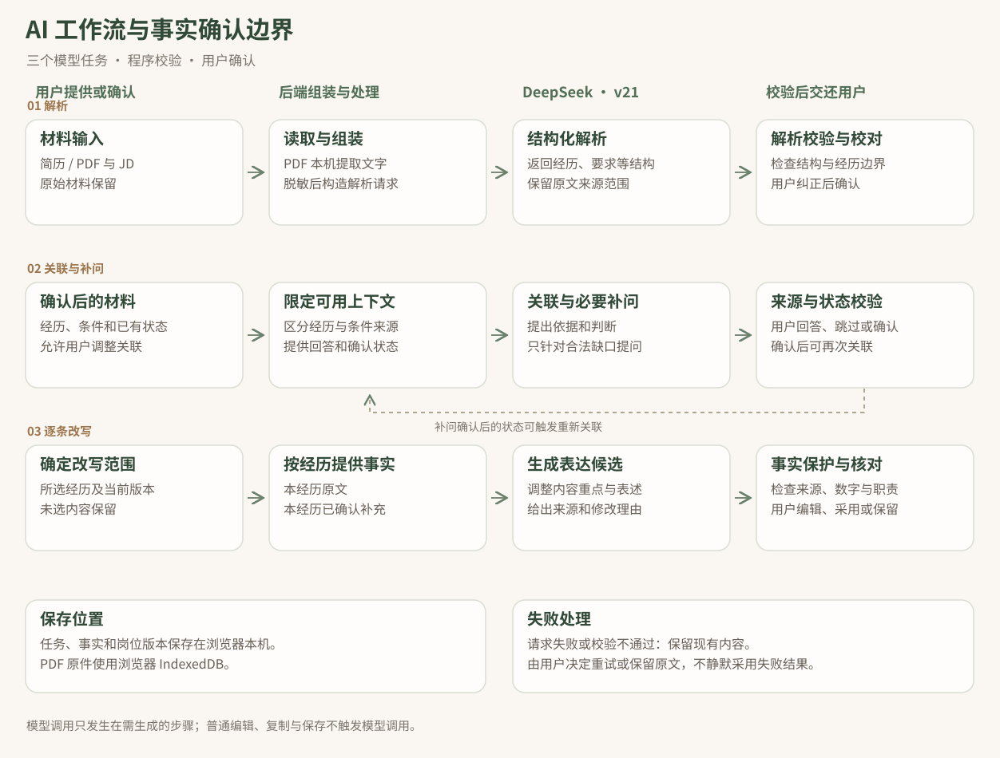

# 用户流程与 AI 工作流

## 用户操作流程

用户先确认材料，再决定哪些经历需要处理。补问用于补足影响表达的事实；用户可以保留未知或跳过。改写后仍需核对，并可保留原文。

[查看可编辑 Mermaid 源码](figures/user-flow.mmd)

## AI 与程序如何协作

| 模型任务 | 提供给模型的内容 | 程序和用户承担的检查 |
| --- | --- | --- |
| 解析 | 简历文字与 JD | 核对结构、原文范围与经历边界；用户纠正 |
| 关联与补问 | 校对后的经历、条件来源、已有回答与确认状态 | 核对来源归属及问题是否合法；用户回答或跳过 |
| 改写 | 所选经历及其原文、已确认补充 | 检查来源、数字、工具和职责限定；用户决定采用文本 |

后端使用兼容 OpenAI API 的接口；展示代码固定读取 v21 Prompt。模型输出使用 JSON，未经确认的补充不能直接变成改写事实。

[查看可编辑 Mermaid 源码](figures/ai-workflow.mmd)

来源：S01、S15—S19、S22、S23，见[证据索引](evidence/source-index.json)。
