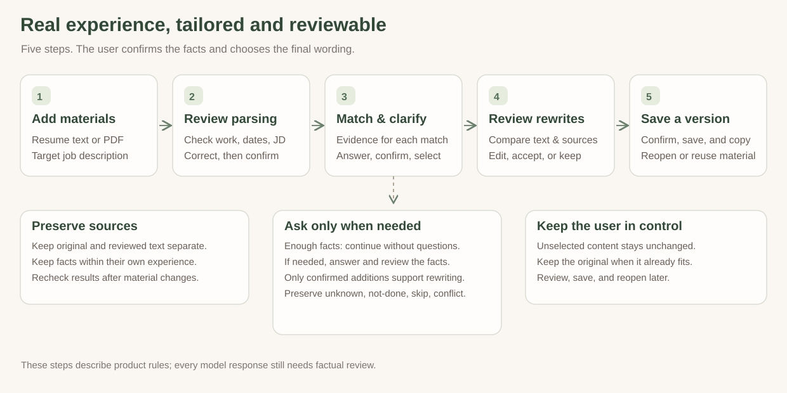

# User Flow and AI Workflow

## User Flow

Users confirm their materials before choosing which experiences to work on. Follow-ups clarify facts that affect wording; users may leave something unknown or skip it. Generated text still requires review, and keeping the original remains an option.

[Editable Mermaid source](figures/user-flow.mmd)

## How the Model and Program Work Together

| Model task | Input to the model | Program and user checks |
| --- | --- | --- |
| Parsing | Resume text and JD | Validate structure, source spans, and experience boundaries; allow user correction. |
| Matching and follow-ups | Reviewed experiences, condition sources, existing answers, and confirmation states | Validate source attribution and question eligibility; let users answer or skip. |
| Rewriting | Selected experiences, their original text, and confirmed additions | Check sources, numbers, tools, and responsibility limits; let users choose the final text. |

The backend uses an OpenAI-compatible API, and the showcase code loads the fixed v21 prompt. Model responses use JSON. Unconfirmed additions cannot directly become rewrite facts.

[Editable Mermaid source](figures/ai-workflow.mmd)

Sources: S01, S15–S19, S22, S23. See the [evidence index](evidence/source-index.json).
